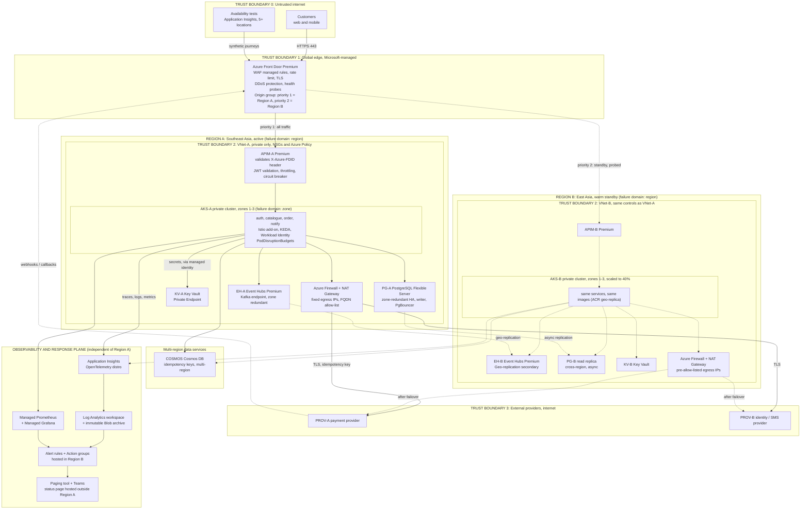
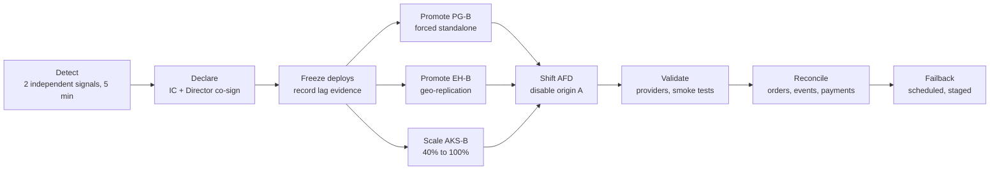

# Tier 1 Digital Service: SRE Assessment

## Microsoft Azure

This assessment uses Azure-native services throughout. The two external providers are third-party payment and identity/SMS APIs reached over the internet; they are dependencies, not part of a hybrid cloud design.

**Author:** Syamsul

## Contents
1. [Scope, assumptions, exclusions](#1-scope-assumptions-and-exclusions)
2. [Architecture diagram](#2-architecture-diagram)
3. [Service reliability model](#3-service-reliability-model)
4. [SLI/SLO specification](#4-slislo-specification)
5. [Observability architecture](#5-observability-architecture)
6. [Resilience architecture](#6-resilience-architecture)
7. [Regional recovery: DR runbook and game-day plan](#7-regional-recovery-dr-runbook-and-game-day-plan)
8. [Incident command model](#8-incident-command-model)
9. [90-day roadmap and governance](#9-prioritised-90-day-roadmap-and-governance)
10. [Security, cost and ownership summary](#10-security-cost-and-ownership-summary)
11. [Validation steps and known limitations](#11-validation-steps-and-known-limitations)
12. [Sources](#12-sources)

---

## 1. Scope, assumptions and exclusions

### Service mapping (reference workload → Azure)
| Reference (AWS) | Azure service used | Short name in this document |
|---|---|---|
| CloudFront (+ WAF) | Azure Front Door Premium + WAF policy + DDoS Network Protection | `AFD` |
| API Gateway | Azure API Management, Premium tier, multi-region | `APIM-A`, `APIM-B` |
| EKS | Azure Kubernetes Service (private cluster, 3 zones) | `AKS-A`, `AKS-B` |
| MSK | Azure Event Hubs Premium (Kafka endpoint) with Geo-replication | `EH-A`, `EH-B` |
| Aurora | Azure Database for PostgreSQL Flexible Server (zone-redundant HA + cross-region read replica) | `PG-A`, `PG-B` |
| (idempotency/session store) | Azure Cosmos DB, multi-region | `COSMOS` |
| Secrets/keys | Azure Key Vault | `KV-A`, `KV-B` |
| Monitoring | Azure Monitor, Application Insights, Log Analytics, Managed Prometheus, Managed Grafana | `AI`, `LAW`, `AMP`, `GRAF` |
| External providers | Provider A (payment), Provider B (identity/SMS) | `PROV-A`, `PROV-B` |

### Assumptions
- **Regions:** Region A = **Southeast Asia** (primary, active). Region B = **East Asia** (recovery, warm standby). They are an Azure region pair; both support availability zones. Data residency allows storing the critical data set in both.
- **Database:** the Aurora workload is PostgreSQL-compatible, so `PG-A` is PostgreSQL Flexible Server. If it were SQL-based, Azure SQL auto-failover groups would replace the replica mechanism (same runbook shape).
- **Critical journeys:** J1 Sign-in, J2 Browse/Search, J3 Checkout/Payment, J4 Notifications/Verification.
- **Providers:** `PROV-A` is the payment provider (supports idempotency keys and a transaction query API). `PROV-B` is identity/SMS verification. Neither offers a regional failover we control.
- **Critical data set:** orders and accounts in `PG-A`, order/fulfilment events in `EH-A`, and idempotency records in `COSMOS`.
- **Capacity:** about 5 product squads (~40 engineers) and a new SRE team of 3 (assumed). Peak traffic and baselines are unknown; thresholds are starting values to be tuned.
- The values in the tables are starting estimates, not measured baselines, unless stated otherwise. Section 9 explains how to replace them with production data.

### Exclusions
Application code changes in detail, full FinOps programme, compliance control mapping (e.g. PCI-DSS, ISO 27001), SIEM/SOC design (Microsoft Sentinel), mobile app internals, DNS registrar/domain operations, active-active multi-region writes (listed as a future option), multi-cloud.

### What the numbers mean
99.99% availability allows 4.32 minutes of downtime in 30 days, 13 minutes per quarter, or about 52.6 minutes per year. A 45-minute regional outage would consume roughly 10 months of that budget:
- The 45-minute RTO is a hard ceiling. The engineering target is to shift traffic within 10 minutes and restore healthy journeys within 20 minutes.
- Most availability protection should come from in-region design: zones, isolation, controlled retries, load shedding and fast rollback.
- Two providers at 99.9% availability could limit a serial journey to roughly 99.8%. That is why both providers have degraded modes (Section 6.5), and the SLO recognises both successful and gracefully degraded outcomes (Section 4.2).

---

## 2. Architecture diagram

The diagram below is rendered by GitHub with Mermaid.



**Reading the diagram**
- **Traffic flow:** customers → `AFD` (WAF, TLS) → `APIM-A` → `AKS-A` → `PG-A` / `EH-A` / `COSMOS`; egress to providers only through `Azure Firewall + NAT Gateway` with fixed IPs. Dotted lines = standby or replication paths.
- **Failure domains:** zone (1-3 inside each region), region (A vs B), and the provider boundary. `AFD`, `COSMOS` and the observability plane are deliberately outside Region A.
- **Security controls shown:** WAF + DDoS at the edge, origin lock-down to Front Door (service tag + `X-Azure-FDID` check), private AKS, Private Endpoints, NSGs, Azure Firewall FQDN egress, managed identities, Key Vault, Azure Policy.

### Failover flow (used by Section 7)


---

## 3. Service reliability model

### 3.1 Journeys, dependencies and failure modes
| Journey | Path | Dependencies | Failure modes | Degraded mode |
|---|---|---|---|---|
| **J1 Sign-in** | `AFD` → `APIM-A` → auth svc → `PG-A`, `COSMOS` | `PROV-B` (MFA), `KV-A` | `PROV-B` latency; DB failover; retry storm on auth; token cache stampede | Cached session validation; TOTP/email fallback |
| **J2 Browse/Search** | `AFD` cache → `APIM-A` → catalogue → `PG-A` replica | `AFD` cache | Cache-miss storm; replica lag; noisy neighbour pods | Serve stale from `AFD` cache |
| **J3 Checkout/Payment** | `AFD` → `APIM-A` → order svc → `PG-A` writer, `EH-A`, `COSMOS` | `PROV-A` | `PROV-A` timeouts → duplicate charges; writer saturation; consumer lag | Accept as "pending", queue authorisation; idempotency keys |
| **J4 Notifications** | `EH-A` → notify consumers → `PROV-B` | `PROV-B` | Lag; poison messages; provider throttling | Deferred send; dead-letter; channel fallback |

### 3.2 Layered control matrix (application, platform, external)
| Layer | Principal risks | Controls | Evidence source |
|---|---|---|---|
| **Application** | Retry amplification, duplicates, slow code paths, bad deploys | Retry budget, idempotency, deadlines, circuit breakers, feature flags (`Azure App Configuration`), canary rollout | `AI` traces, `requests`/`dependencies` tables |
| **Platform** | Zone/region loss, node pressure, quota exhaustion, DB connection saturation, lag | 3-zone AKS, KEDA, PgBouncer, quotas mirrored in Region B, geo-replication | Azure Monitor metrics, Container Insights, Resource Health |
| **External** | `PROV-A`/`PROV-B` outage or throttling, IP allow-list drift | Circuit breakers, degraded modes, provider SLO tracking, pre-registered Region B egress IPs | Dependency spans, provider status feeds, contract SLAs |

### 3.3 The retry-storm model (cause of the two incidents)
Attempts multiply per layer: with *n* layers each making *k* attempts, load on the failing tier is up to *k^n*. Example: client 3 × APIM 3 × mesh 3 = **27×**. Fix: retries in **one** layer, ≤2 retries, 10% budget (6.2).

### 3.4 Error budgets and policy
| SLO | Budget / 30 d | Policy trigger |
|---|---|---|
| 99.99% | 4.32 min | >50% consumed → reliability work tops the backlog for that service. 100% consumed → feature freeze for that journey until budget recovers, except reliability/security fixes. Exception needs Product **and** Engineering head sign-off. |
| 99.95% | 21.6 min | Same rule |
| 99.9% | 43.2 min | Same rule |

Provider incidents are **not** excluded (customers feel them). Pre-agreed exclusions only: announced maintenance with ≥5 days' notice, and client-caused 4xx.

### 3.5 Ownership (RACI)
| Area | R | A | C |
|---|---|---|---|
| Journey SLOs, runbooks, first-line on-call | Service team | Service engineering manager | SRE |
| SLO tooling, alert standards, game-day framework | SRE | Head of Platform | Service teams |
| `AKS`, `EH`, `PG`, `AFD`/`APIM` platform health | Platform | Head of Platform | SRE |
| Provider SLAs and escalation | Product owner / vendor manager | Product owner | SRE, Security |
| Error-budget decisions | Service team | Product + Engineering heads (joint) | SRE |
| DR readiness and tests | SRE facilitates, Service teams execute | Head of Engineering | Security, Risk, Finance |
| Incident command rota | SRE + senior engineers | Head of Engineering | All |

Principle: **service teams own their reliability; SRE owns the method, tooling and independent review.** This resolves the ownership disagreement.

---

## 4. SLI/SLO specification

### 4.1 Customer-journey SLOs (rolling 30 days)
| ID | Journey | Good event | Valid event | Measured at | SLO | Owner | Source |
|---|---|---|---|---|---|---|---|
| SLO-J1 | Sign-in | HTTP status not 5xx **and** latency ≤ 800 ms (p99 view) | All sign-in requests excluding 4xx caused by bad input | `AFD` access logs + availability test | **99.99%** | Auth team | `LAW` (`AzureDiagnostics`, FrontDoorAccessLog) |
| SLO-J2 | Browse/Search | non-5xx and ≤ 500 ms | All GETs on catalogue routes | `AFD` | **99.95%** | Catalogue team | `LAW` |
| SLO-J3a | Checkout request | Order accepted (or queued with confirmation) and ≤ 2.5 s | All checkout POSTs | `AFD` + `AI` | **99.99%** | Order team | `LAW`, `AI` |
| SLO-J3b | Payment outcome | Final outcome known ≤ 60 s | All payment attempts | Business metric `payment_outcome_seconds` | **99.95%** | Order team | `AI` custom metrics |
| SLO-J4 | Notifications | Delivered ≤ 60 s of event | All notification events | Consumer lag + provider callback | **99.9%** | Notify team | `AMP`, `AI` |

Measurement is **at the edge** (customer view), cross-checked by external availability tests. Pod-level health is diagnostic only.

### 4.2 Dependency and recovery SLIs (to explain and contain budget burn)
| ID | SLI | Target | Purpose |
|---|---|---|---|
| DEP-A | `PROV-A` success rate and p99 latency (client spans) | tracked, no hard SLO we control; breaker opens at >50% errors | Separate "us" from "them" |
| DEP-B | `PROV-B` success rate and p99 latency | same | same |
| PLT-1 | `EH` consumer lag, checkout group | p99 < 30 s (alert 2 min) | Queue health |
| PLT-2 | `PG-A` connections used / max | < 85% | Prevent saturation |
| REC-1 | `PG-B` replica lag | p99 < 60 s (hard limit 5 min = RPO) | RPO evidence |
| REC-2 | `EH-B` geo-replication lag | p99 < 60 s | RPO evidence |

### 4.3 Burn-rate alerting (30-day windows, multi-window)
| Severity | Burn rate | Long / short window | Budget consumed | Action |
|---|---|---|---|---|
| SEV1 page | 14.4× | 1 h / 5 min | 2% | Page immediately |
| SEV2 page | 6× | 6 h / 30 min | 5% | Page |
| Ticket | 3× | 1 d / 2 h | 10% | Ticket, next business day |
| Ticket | 1× | 3 d / 6 h | 10% | Backlog review |

### 4.4 Example SLI query (KQL)
Check the column names against the deployed diagnostic configuration.
```kusto
// SLI for SLO-J1 (sign-in availability), 5-minute bins
AzureDiagnostics
| where Category == "FrontDoorAccessLog"
| where requestUri_s has "/api/auth/signin"
| extend status = toint(httpStatusCode_s), latencyMs = todouble(timeTaken_s) * 1000
| summarize valid = count(),
            good  = countif(status < 500 and latencyMs <= 800)
          by bin(TimeGenerated, 5m)
| extend sli = todouble(good) / valid, burn = (1.0 - sli) / (1.0 - 0.9999)
| project TimeGenerated, valid, good, sli, burn
```

---

## 5. Observability architecture

| Area | Design (Azure-native) |
|---|---|
| **Telemetry standard** | OpenTelemetry via the **Azure Monitor OpenTelemetry Distro** → `AI` (workspace-based, writes to `LAW`). Mandatory resource attributes on every signal: `journey`, `service`, `owner`, `region`, `zone`, `version`. Enforced by Azure Policy tag rules and a CI lint; no tags → no dashboard/alert. |
| **Correlation** | W3C `traceparent` created or accepted at `AFD`, passed through `APIM` policy and propagated through AKS services and as `Event Hubs` message properties. JSON logs carry `trace_id`, `span_id`. Provider calls emit client spans with the provider's request ID. |
| **Service map** | `AI` **Application Map** for the dependency graph (including `PROV-A`, `PROV-B` as external nodes), **Container Insights** + `AMP` for AKS, **Connection Monitor** (Network Watcher) for network paths. `EH`/`PG` platform metrics for lag, throttling, replication. |
| **Synthetic checks** | `AI` **Standard availability tests** every 1 min from ≥5 locations (one set outside Southeast and East Asia). Two sets: public URL (customer path) and each region's origin directly (so `Region B` is known healthy before it is needed). Multi-step tests for J1 and J3 using sandbox accounts. |
| **Real-user monitoring** | `AI` browser SDK for client-side errors and page timings; compared against synthetic results to expose segment-specific failures. |
| **Business signals** | Custom metrics: `orders_per_min`, `payment_success_rate{provider}`, `login_success_rate`, `notification_latency_seconds`. Dynamic-threshold alert rules detect "all HTTP 200 but nobody can buy". |
| **Retention** | `LAW`: interactive 30 days (90 for audit tables), noisy tables on Basic/Auxiliary tier, long-term archive/export to **immutable Blob storage** 13 months (7 years if regulated). Traces 30 d full, errors 90 d. Metrics 93 d platform + `AMP` 18 months. Cost controls: adaptive sampling (100% errors/slow, 5% baseline, higher for checkout), no high-cardinality labels. |
| **Alert routing** | Page only on symptoms: SLO burn (4.3), multi-location availability failure, business-signal collapse. Cause alerts (CPU, restarts) become tickets unless predictive (e.g. `PG-A` connections >85%, lag growing >10 min). Path: Azure Monitor alert rule → **alert processing rules** (route by `owner` tag, suppress during planned maintenance) → **action groups** → paging tool + Teams. Each alert links to a runbook. KPI: >80% of pages actionable. |
| **Independence** | Alert rules, action groups, dashboards (`GRAF`) and the status page run in Region B or outside Azure Region A, so monitoring survives the failure it reports. **Service Health** and **Resource Health** alerts are routed to the same paging path. |

Retry-amplification query:
```kusto
// Detect retry storms: calls per operation to the same dependency
dependencies
| where timestamp > ago(15m) and type has "HTTP"
| summarize attempts = count() by operation_Id, target
| summarize amplification = avg(todouble(attempts)), p99 = percentile(attempts, 99) by target
| where amplification > 1.2
```

---

## 6. Resilience architecture

### 6.1 Timeouts (deadline propagation)
Timeouts shrink downstream so the caller gives up **after** the callee: `AFD` origin 30 s → `APIM` backend 10 s → service-to-service 3 s → `PG`/provider 1-2 s. The remaining deadline travels in `x-request-deadline`; services refuse work they cannot finish. Values set from measured p99.9, not guessed (otherwise cold starts cause false failures).

### 6.2 Retry budgets
- Retry in **exactly one layer per hop** (the service client library). Disable retries in `APIM` and in the Istio route for mutating calls.
- Max **2 retries**, exponential backoff with **full jitter**, honour `Retry-After`.
- **Retry budget:** retries ≤ **10%** of baseline request volume per client (token bucket); when exhausted, fail fast.
- Never retry non-idempotent calls without an idempotency key.
- Verified with **Azure Chaos Studio** latency/error experiments; success criterion: amplification factor ≤ 1.2×.

### 6.3 Idempotency
- Clients send `Idempotency-Key`. The order service writes key + response hash to `COSMOS` with a conditional create and TTL (24-72 h).
- The key is also passed to `PROV-A` (provider-side idempotency).
- `EH` producers use idempotent settings with acks from all replicas; consumers dedupe by event ID (inbox table); the **outbox pattern** keeps the `PG-A` write and the event publish atomic.
- **Trade-off:** `COSMOS` multi-region replication is asynchronous, so a key written just before a regional failure may be unseen in Region B. Mitigation: `PROV-A` idempotency plus the reconciliation job (7.5).

### 6.4 Circuit breaking, bulkheads and backpressure
| Control | Azure implementation | Setting (starting value) |
|---|---|---|
| Provider circuit breakers | Application library + Istio outlier detection; `APIM` backend circuit breaker | Open at >50% errors in 20 calls or latency >2× timeout; half-open probes at 10% |
| Connection protection | `PG-A` built-in **PgBouncer**; per-service connection pools | Cap total connections < 85% of max |
| Edge shaping | `AFD` WAF rate-limit rules; `APIM` `rate-limit-by-key` and quotas | Per-client and per-route limits |
| Bulkheads | Separate AKS node pools for checkout vs batch; per-dependency concurrency limits | Checkout pool never shares nodes with C3 work |
| Autoscaling | HPA + **KEDA** (on `EH` lag and request rate), Node Auto Provisioning/cluster autoscaler | Scale-out lead time tested monthly |

### 6.5 Provider degraded modes
| Provider | Failure | Behaviour |
|---|---|---|
| `PROV-A` (payment) | Breaker open | Accept order as "pending payment", queue authorisation on `EH` with backoff, notify customer; bounded by time and value limits, then fail cleanly. Secondary route if the contract permits. |
| `PROV-B` (identity/SMS) | Breaker open | Step-up fallback (TOTP/email); skip optional verification for low-risk actions per Security-approved policy. |

### 6.6 Queue recovery
Retry tiers (1 min, 10 min) and a dead-letter destination per consumer group. KEDA scales consumers on lag. Alerts: lag >2 min (checkout), >10 min (notifications). **Replay tool** is rate-limited to ≤50% of spare capacity so catch-up cannot become a self-inflicted storm. Poison messages are quarantined after N attempts instead of blocking a partition.
*Trade-off:* the Event Hubs Kafka endpoint supports the Kafka protocol but not every Kafka feature; transactions, compaction and Streams usage must be checked before committing (see Section 11).

### 6.7 Load shedding
| Class | Examples | Shed order |
|---|---|---|
| C0 | Checkout, payment | never first |
| C1 | Sign-in | 4th |
| C2 | Browse, search | 3rd (serve stale from `AFD`) |
| C3 | Background, analytics, exports | 1st |

Under saturation (CPU >80%, queue depth, concurrency exceeded) services return `503 + Retry-After`. **Azure App Configuration** feature flags disable expensive features in seconds, without a deploy.

### 6.8 Capacity strategy
- **N+1 zone:** survive loss of one of 3 zones at peak (≈150% of peak across zones for the critical tier).
- AKS: on-demand base nodes, spot only for C3; pause pods for fast headroom; watch subnet IP exhaustion.
- **Quotas:** monitor subscription quotas (vCPU families, public IPs, Event Hubs units, APIM units) at 70%; **identical quotas pre-approved in Region B**. This is the most common hidden DR failure.
- Monthly load test to 1.5× peak; quarterly test to the breaking point.

---

## 7. Regional recovery: DR runbook and game-day plan

### 7.1 Strategy: warm standby
Region B runs `AKS-B` at ~40% scale, `PG-B` replica, `EH-B` geo-replica, `APIM-B`, and replicated images/secrets. *Pilot light* is cheaper but cannot reliably meet 45 min with human decision time; *active-active* needs a write-conflict model the app lacks (future option).

| Layer | Mechanism | Behaviour and trade-off |
|---|---|---|
| Edge | `AFD` origin group, priority routing, **deep** health probes | Failover is probe-based (roughly 30-60 s detection at the configured probe interval and sample count). A shallow probe returns 200 while the database is gone, so the probe endpoint checks real dependencies. `AFD` is a global service; manual override (disable origin) is pre-built and rehearsed. |
| Database | `PG-B` cross-region **read replica**, promoted on declaration | Replication is asynchronous; forced promotion can lose the un-replicated tail. Alert at 60 s lag. **Geo-redundant backup is not enough**: restore-based RPO can approach an hour. |
| Events | `EH` **Geo-replication** (replicates data and metadata) | Asynchronous; offsets/in-flight events can lag, hence idempotent consumers. The metadata-only geo-disaster-recovery pairing does **not** meet the RPO. |
| Idempotency | `COSMOS` multi-region | Eventually consistent between regions (6.3). |
| Secrets/images/config | `KV` (Azure paired-region replication is read-only during failover, so a second vault `KV-B` holds writable copies), **ACR geo-replication**, same Bicep/Terraform pipeline to both regions | Parameters synced by pipeline, never by hand. |
| Storage (if used) | RA-GZRS | GRS-class replication has a typical RPO up to ~15 min, so critical data is not stored only in blob storage. |

### 7.2 Failure detection
Region-impaired is declared when **two independent signals** hold ≥5 min, evaluated **outside** Region A:
1. External availability tests failing from multiple locations for J1/J3,
2. Journey SLO fast burn (14.4×) with zone-level mitigation tried or impossible,
3. Azure Service Health / Resource Health event, or `PG-A` writer unavailable.

Target detection ≤5 min.

### 7.3 Authority and access
- **Declaration:** the Incident Commander decides, with the on-call **Engineering Director (or delegate) as pre-authorised co-signer** who must answer within 5 min. Default rule: if still failing at **T+15 min** with no credible fix, failover proceeds unless explicitly vetoed. No committee.
- **Access:** operators hold standing least-privilege access; failover actions use **Privileged Identity Management (PIM)** role activation, pre-staged and tested quarterly, plus two **break-glass accounts** excluded from conditional-access dependencies and monitored by alerts.

### 7.4 Runbook (time-boxed to the 45-minute ceiling)
| T+ | Step | Owner | Verification |
|---|---|---|---|
| 0-5 | Detect, page, assign IC | On-call | Two signals logged |
| 5-10 | Declare; freeze deploys; **record** `PG-B` lag, `EH-B` lag, last `COSMOS` write time (RPO evidence) | IC + Data lead | Numbers in decision log |
| 10-15 | **Promote `PG-B`** (forced standalone); promote `EH-B`; scale `AKS-B` to 100% (KEDA/HPA minimums via GitOps) | Platform | Writer accepting writes; `EH-B` active |
| 15-20 | **Shift traffic:** `AFD` origin A disabled, origin B priority 1 | Platform | Probes healthy; requests reaching `APIM-B` |
| 20-30 | **Dependency validation** (7.5); smoke tests; canaries green from 3+ locations; business metrics recovering | Ops lead | Section 7.5 checklist |
| 30-45 | Start **reconciliation** (7.6); comms update; hold for stability | IC + Comms | No SLO regression for 10 min |

Example commands for the game-day procedure; validate the syntax against the deployed Azure CLI version:
```bash
# Database: forced promotion of the cross-region replica (unplanned failover)
az postgres flexible-server replica promote \
  --resource-group rg-prod-eastasia --name pg-b \
  --promote-mode standalone --promote-option forced

# Edge: take Region A origin out of rotation
az afd origin update \
  --resource-group rg-prod-global --profile-name afd-prod \
  --origin-group-name og-api --origin-name origin-a \
  --enabled-state Disabled
```
Front Door origin group definition (Bicep, abbreviated; names match the diagram):
```bicep
resource ogApi 'Microsoft.Cdn/profiles/originGroups@2023-05-01' = {
  parent: afd
  name: 'og-api'
  properties: {
    loadBalancingSettings: { sampleSize: 4, successfulSamplesRequired: 3, additionalLatencyInMilliseconds: 50 }
    healthProbeSettings: { probePath: '/health/deep', probeRequestType: 'GET', probeProtocol: 'Https', probeIntervalInSeconds: 30 }
  }
}
resource originA 'Microsoft.Cdn/profiles/originGroups/origins@2023-05-01' = {
  parent: ogApi
  name: 'origin-a'
  properties: { hostName: 'apim-a.azure-api.net', priority: 1, weight: 1000, enabledState: 'Enabled' }
}
resource originB 'Microsoft.Cdn/profiles/originGroups/origins@2023-05-01' = {
  parent: ogApi
  name: 'origin-b'
  properties: { hostName: 'apim-b.azure-api.net', priority: 2, weight: 1000, enabledState: 'Enabled' }
}
```

### 7.5 Dependency validation
- `PROV-A` and `PROV-B`: **Region B NAT/Firewall public IPs already allow-listed**; webhook/callback URLs resolve via `AFD` regardless of region; API credentials and certificates present in `KV-B`; provider quotas confirmed.
- Automated post-shift smoke tests: sign-in, search, sandbox checkout, notification; also run monthly before any incident.
- Region B DNS, egress (Azure Firewall rules) and managed-identity role assignments tested monthly.

### 7.6 Reconciliation
1. Capture the failover point (last replicated transaction timestamp/LSN, `EH` offsets, `COSMOS` last write).
2. After Region A recovers, compare orders/events in the old primary (read-only snapshot) to Region B.
3. Reconcile payments against **`PROV-A`'s transaction/settlement API** (source of truth for money); replay missing events through idempotent consumers.
4. Report: orders affected, duplicates prevented, financial exposure. Finance and Support sign off.

### 7.7 Failback
Scheduled, never during the incident. Preconditions: Region A stable ≥24 h, `PG-A` rebuilt as a replica of `PG-B` and lag steady, `EH` replication reversed, change freeze agreed. Use **planned switchover** (zero data loss) in a quiet window, then re-enable origin A and move traffic 5% → 25% → 100% with predefined rollback criteria and a 30-min hold at each stage. Avoid flapping: no automatic fail-back.

### 7.8 Game-day plan (Azure Chaos Studio + manual drills)
| Stage | When | Scope | Success criteria | Abort / safety |
|---|---|---|---|---|
| 1. Tabletop | Month 1 | Walk 7.4 with all owners; find gaps in authority, quotas, IPs, PIM | Gap list closed | n/a |
| 2. Non-prod full failover | Month 2 | Promote `PG-B`, `EH-B`, shift `AFD`, reconcile | Measured RTO and RPO documented | Reset script ready |
| 3. Prod partial | Month 3 | 5% then 25% of real traffic to Region B; Chaos Studio zone/pod/network faults on `AKS-A` | No breach beyond agreed budget; amplification ≤1.2× | Alert on burn >6×; named stop-button owner |
| 4. Prod full evacuation | Next quarter, off-peak | Full shift to Region B, then failback | RTO ≤45 min, RPO ≤5 min, journeys healthy | Customer comms ready; abort if SEV1 burn persists |

Each game day has a written hypothesis, abort criteria, observers, and a published report with tracked fixes. Repeat at least twice a year and after major architecture change.

---

## 8. Incident command model

### 8.1 Severity criteria
| Sev | Criteria | Response |
|---|---|---|
| **SEV1** | Critical journey down or burn >14.4× for ≥5 min; data loss/corruption or security breach risk; regional failover under consideration | Immediate page, full roles, execs notified |
| **SEV2** | Degraded journey (burn ~6×); single-provider outage with workaround; visible customer impact | Page, IC, 30-min updates |
| **SEV3** | Minor or segment-limited impact; slow budget burn | Ticket, business hours |
| **SEV4** | No customer impact | Backlog |

Any responder can raise severity; only the IC lowers it.

### 8.2 Roles
**Incident Commander** (decides, does not debug), **Ops lead**, **Communications lead**, **Scribe**, **Provider liaison**, and **SMEs**. Primary and secondary IC rota with training and shadowing.

### 8.3 Communication cadence
| | Internal | Customer / status page | Executives |
|---|---|---|---|
| SEV1 | every 15 min | first update ≤15 min, then every 30 min | at start, then hourly |
| SEV2 | every 30 min | on visible impact | at start and resolution |

Dedicated Teams channel and bridge per incident; the status page is hosted outside Region A.

### 8.4 Decision log
Scribe records: timestamp, decision, decider, evidence, alternatives rejected, expected effect. Mandatory for severity changes, failover/no-failover, rollback, load-shedding, and customer communications. It feeds the postmortem timeline directly.

### 8.5 Escalation
No acknowledgement in 5 min → secondary → engineering manager → director. At SEV1, open an **Azure support request** and check **Service Health** first to rule out platform events. Providers escalated through contract-defined contacts with ticket numbers recorded.

### 8.6 Evidence
Collected into a dedicated **immutable Blob storage** container: dashboard snapshots, `AI` traces, `LAW` exports, **Activity Log** (who changed what), deployment records. First query of every incident: "all changes in the last 2 hours".

### 8.7 Handover
Structured template at shift/IC change (max 2 h per IC on SEV1): current state and impact, hypotheses ruled in/out, actions in flight, next decisions and owners, comms due. Verbal handover logged by the scribe.

### 8.8 After the incident
Blameless review within 5 working days for SEV1/2. Actions have owners and dates, enter the owning team's backlog, and SRE tracks closure. The review asks about detection time, time to mitigate, runbook quality, and retry amplification.

---

## 9. Prioritised 90-day roadmap and governance

### 9.1 Prioritisation method
**Risk score = (Likelihood 1-5) × (Journey impact 1-5) × (Detection gap 1-5) ÷ Effort (S=1, M=2, L=3).**
Replace the starting estimates with: 12 months of incident and postmortem data; error-budget burn by journey; paging and ticket toil (pages per shift, runbook time and repeat tickets); alert history from Azure Resource Graph (`alertsmanagementresources`) and `LAW`; and DR test results.

### 9.2 Backlog
Scores and owners are starting points and should be adjusted after the production baseline is available.
| # | Item | Why | Effort | Score | Phase |
|---|---|---|---|---|---|
| 1 | SLOs and burn-rate paging for J1-J4 [SRE + service teams] | Slow detection | M | 20 | 0-30 d |
| 2 | Timeout/retry-budget standard; remove stacked retries on checkout and auth [Service teams] | Two retry-storm incidents | M | 25 | 0-30 d |
| 3 | Availability tests from 5 locations + RUM + business metrics [SRE] | See customer impact | M | 16 | 0-30 d |
| 4 | Alert audit: demote cause alerts, add runbook links [SRE] | Alert fatigue/toil | S | 12 | 0-30 d |
| 5 | RACI, on-call, severity policy, IC rota live [Eng heads] | Ownership dispute | S | 12 | 0-30 d |
| 6 | Idempotency keys + inbox/outbox on checkout and consumers [Order team] | Safe retries, duplicates | M | 18 | 31-60 d |
| 7 | PgBouncer limits, provider circuit breakers, load-shedding tiers [Platform + teams] | Containment | M | 15 | 31-60 d |
| 8 | DR gaps: quotas, egress IP allow-lists, `EH` geo-replication, `PG-B`, ACR/KV replication, `AFD` origins [Platform] | Prerequisite to any DR test | L | 24 | 31-60 d |
| 9 | Chaos Studio: retry amplification and zone-loss tests in non-prod [SRE] | Verification | M | 10 | 31-60 d |
| 10 | Game-day Stages 1-3 [SRE + all] | DR never exercised | L | 22 | 61-90 d |
| 11 | Production readiness review; error-budget policy enforced [SRE + Eng heads] | Governance | S | 10 | 61-90 d |
| 12 | Failback runbook + reconciliation tooling [Platform + Order team] | Complete recovery loop | M | 14 | 61-90 d |

**Deferred on purpose:** active-active writes, observability cost tuning beyond quick wins, extended compliance mapping.

### 9.3 Balancing investment with delivery capacity
- Reserve about **20% of each service squad's capacity** for reliability in the first 90 days (≈1 FTE per squad), falling to **10-15%** once SLOs are healthy, plus the SRE team (3 people) as a multiplier on tooling and reviews.
- Capacity moves automatically with budget: healthy → more features; burning → reliability share grows. This is agreed in advance with Product and written into the error-budget policy.

### 9.4 Programme metrics
| Group | Metric | Target |
|---|---|---|
| Outcome | SLO attainment per journey; error-budget burn | SLOs met 3 months running |
| Detection/response | MTTD (SEV1); MTTA; MTTR; % incidents found by monitoring rather than customers | MTTD <5 min; >90% self-detected |
| Quality | Retry amplification; % actionable pages; pages per on-call shift; repeat-incident rate | ≤1.2×; >80%; ≤2 per 12 h; falling |
| Recovery | Measured RTO/RPO per game day; open DR gaps | ≤45 min / ≤5 min; zero critical gaps |
| Toil/capacity | SRE toil share; % squad capacity on reliability | <50%; ~20% falling to 10-15% |

### 9.5 Governance: preventing SRE becoming an operations dumping ground
1. **Engagement model:** SRE supports services with an owner, SLO, runbook and a passed **production readiness review**. No SLO, no SRE.
2. **First-line on-call stays with service teams.** SRE owns platform on-call and escalation, not every product's pages.
3. **50% cap on ops/toil work** for SRE. Above it, work is automated or handed back and the Head of Engineering is told.
4. **Single visible intake backlog** with risk/toil data; no work by chat or ad-hoc request.
5. **Error-budget policy** gives teams and SRE shared language to say no to risky launches; Product co-owns the decision.
6. **Cadence:** monthly reliability review (service owners, SRE, Product); quarterly roadmap and DR report to leadership.
7. **Rotation:** engineers rotate between product teams and SRE to avoid a silo.

---

## 10. Security, cost and ownership summary

### Security
| Boundary | Controls |
|---|---|
| Internet → edge | `AFD` WAF (managed rules + rate limiting), DDoS Network Protection, TLS 1.2+, bot protection |
| Edge → origin | `APIM` accepts only Front Door (service tag + `X-Azure-FDID` header validation); JWT validation at `APIM` |
| Workload | Private AKS, Private Endpoints for `PG`, `EH`, `KV`, `COSMOS`; NSGs; Azure Policy; Workload Identity (no static secrets); Defender for Cloud |
| Egress | Azure Firewall FQDN allow-list; NAT Gateway fixed IPs registered with providers |
| Secrets/keys | `KV` with RBAC, soft delete + purge protection, rotation alerts (expiry is a failure mode) |
| Access | Entra ID, least privilege, PIM for failover roles, monitored break-glass accounts |
| Audit | Activity Log and diagnostics to `LAW` and immutable Blob (7.3, 8.6) |

### Cost (qualitative; validate with the Azure pricing calculator)
Warm standby adds roughly **40-60% of production run-cost** (assumed): standby compute at 40% scale, replica/geo-replication, a second `APIM` Premium unit, cross-region egress, plus availability-test and telemetry volume. Levers: sampling and log tiers, spot nodes for C3, scale-to-100% only during tests/incidents, reserved capacity for steady-state. The cost is justified against the 99.99% target and the 45-minute RTO that pilot-light could not reliably meet.

### Operational ownership
See the RACI in 3.5; ownership of reliability sits with service teams, SRE owns method and tooling, DR is jointly run and tested by SRE and service teams.

---

## 11. Validation steps and known limitations

### Validation steps (how each claim is proved)
| Claim | Validation |
|---|---|
| SLIs are correct | Compare `AFD`-log SLI with availability-test results for 2 weeks; investigate divergence >0.05% |
| Alert quality | Replay 12 months of incidents against burn-rate rules; measure detection time and false positives |
| Retry budget works | Chaos Studio latency injection on `PROV-A`; amplification ≤1.2× and breaker opens as designed |
| Idempotency | Replay duplicate checkout requests (incl. across a forced failover in non-prod); zero duplicate charges |
| Queue recovery | Pause consumers 15 min, resume with replay throttle; lag clears without SLO breach |
| RPO ≤ 5 min | Record `PG-B`/`EH-B` lag continuously; confirm in game days Stage 2-4 |
| RTO ≤ 45 min | Time Stage 2 and Stage 4 against the 7.4 timeline; publish report |
| DR dependencies | Monthly automated Region B smoke test incl. provider sandbox calls and allow-list check |

### Known limitations
- **No hands-on testing or measured baselines.** Thresholds, SLO targets for J2/J4, cost uplift and risk scores are starting hypotheses to be validated with real traffic and incident data.
- **Azure feature behaviour must be re-verified** against current Microsoft documentation before implementation: Event Hubs Kafka-feature coverage (transactions, compaction, Streams) and geo-replication semantics; PostgreSQL Flexible Server cross-region replica promotion options and any endpoint/connection-redirection features; Front Door probe interval/sample behaviour and Private Link support for the chosen origin; APIM backend circuit-breaker capabilities; Key Vault paired-region replication behaviour; Log Analytics table/column names; CLI syntax.
- **Front Door is a global control-plane dependency** and probe-based failover is not instantaneous; mitigated by deep probes, rehearsed manual override and a fast declaration rule.
- **Asynchronous replication** (`PG`, `EH`, `COSMOS`) means bounded data loss on unplanned failover; the 5-minute RPO holds only while lag stays low, which is why lag is an alerting SLI.
- **99.99% for a regional event is not achievable with an RTO of 45 min.** The design reduces probability and duration; leadership should accept that a regional event consumes the budget (or fund active-active later).
- **External providers** have unknown SLAs, regional behaviour and allow-listing lead times; these are validated through contract review and the provider liaison role.
- **Single DR region pair and warm standby only;** simultaneous failure of both regions and provider-side outages beyond degraded modes are out of scope.

---

## 12. Sources and review

I reviewed the assumptions, architecture, runbooks, examples and current Azure product references in this submission. I confirmed the final service names and shortened identifiers used across the document and diagrams, while noting where implementation details still require live testing or validation against current product documentation.

### AI assistance
This document was prepared with AI assistance. AI was used to structure the assessment, draft the diagrams and tables, and suggest Azure mappings for the reference workload. I reviewed and confirmed the content presented here and take responsibility for the final submission.

The AI did not deploy or test the proposed configuration in an Azure environment. The validation steps and known limitations are documented in Section 11.

### References
- Google SRE Book and SRE Workbook: SLOs, error budgets, multi-window burn-rate alerting, incident management (https://sre.google/books/)
- Microsoft Azure Well-Architected Framework: Reliability pillar (https://learn.microsoft.com/azure/well-architected/)
- Azure Architecture Center: multi-region and mission-critical workload guidance (https://learn.microsoft.com/azure/architecture/)
- Microsoft Learn product documentation: Azure Front Door, API Management, AKS, Event Hubs, Azure Database for PostgreSQL Flexible Server, Cosmos DB, Key Vault, Azure Monitor/Application Insights, Azure Chaos Studio (https://learn.microsoft.com/azure/)
- AWS reference workload names as given in the assessment brief.

### Submission checklist
- [x] Microsoft Azure is stated and used consistently.
- [x] The architecture diagram shows trust boundaries, traffic flow, failure domains, security controls and key service names.
- [x] Assumptions and exclusions are explicit.
- [x] Diagram and code identifiers use consistent names.
- [x] Security, cost and operational ownership are addressed.
- [x] Validation steps and known limitations are included.
- [x] Sources and AI assistance are disclosed.
